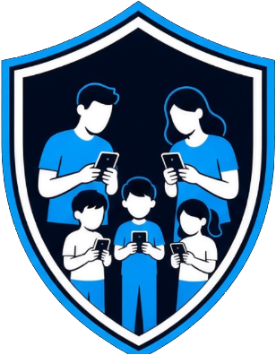
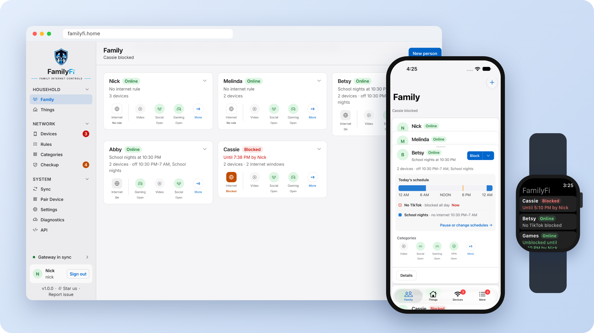
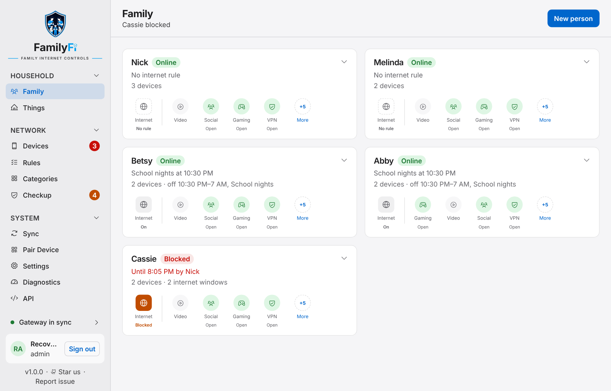
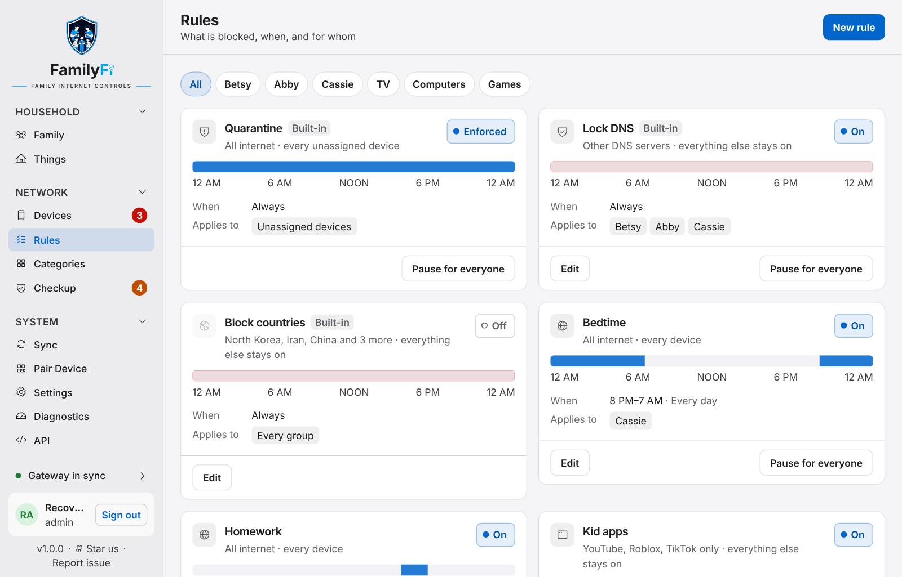
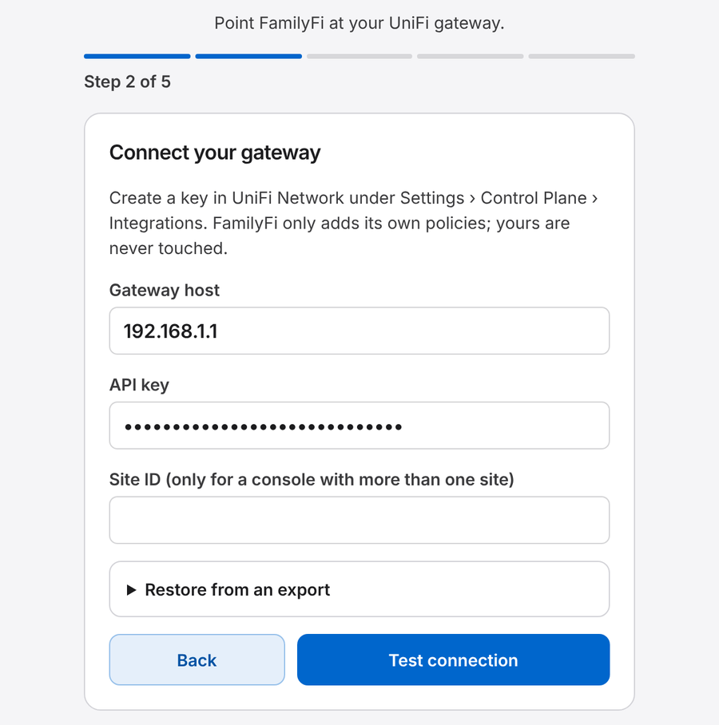

<p align="center">
  
</p>

<h1 align="center">FamilyFi</h1>

<p align="center">
  <strong>Simple internet controls for your family, on the UniFi network you already have.</strong>
</p>

<p align="center">
  <a href="https://demo.getfamilyfi.com"><strong>Try the live demo</strong></a> ·
  <a href="#install">Install</a> ·
  <a href="https://github.com/nickberardi/familyfi/wiki">User guide</a> ·
  <a href="https://getfamilyfi.com">getfamilyfi.com</a>
</p>

Bedtime, homework hours, and the new tablet nobody has claimed yet. FamilyFi lets you set the rules the way your family talks about them, then has your UniFi gateway keep them. Pause the internet for anyone with one tap, from a browser at home or the FamilyFi app on iPhone, iPad, Apple Watch and Android.



## What you can do

- **Organize by people, not by device.** Put everyone's phones, tablets and consoles into a group for that person. Things like the living room TV or the smart home kit get groups of their own.
- **Set rules with schedules.** Turn off all internet, or just video, social media, gaming, certain apps or certain websites. Do it always, or only at times like *Bedtime* or *Homework* on school days until six.
- **Pause and allow.** Pause the internet for dinner, for an hour or until you resume it. Or let someone back online for a while during a scheduled block. You can always see who paused it and until when.
- **Catch new devices.** New phones and tablets show up as unassigned. Turn on quarantine and they stay offline until you say whose they are, so a birthday present doesn't skip every rule in the house.
- **Check on things.** Checkup points out anything that needs a look, such as a phone using a private Wi-Fi address that could slip out of its rules.





## How it works

FamilyFi runs on a small computer in your home and connects to your UniFi console. It turns your rules into firewall rules on the gateway, so the gateway does the blocking.

- **Your gateway keeps the rules.** Schedules live on the gateway itself, so bedtime still starts on time while FamilyFi restarts or updates.
- **Your own settings stay yours.** FamilyFi only changes the rules it creates. Anything you set up yourself in UniFi is never changed, turned off, deleted or reordered.
- **Everything is kept at home.** There is no FamilyFi cloud account, and nothing about your household is sent to us. Your information is stored on your own computer, and your UniFi key is stored encrypted.
- **Only parents sign in.** Only the adults you make admins can sign in. Children and teens never get a FamilyFi login.

## What you need

- A **UniFi console** running UniFi Network, such as a Cloud Gateway, Dream Machine or Dream Router.
- A **computer at home that stays on and runs Docker**: a mini PC, a NAS with Docker, a Raspberry Pi 4 or 5, or a home server. Don't install FamilyFi on the UniFi gateway itself.
- About **ten minutes**.

## Install

On that computer, make a folder for FamilyFi and run these three commands in it:

```bash
curl -fsSLO https://raw.githubusercontent.com/nickberardi/familyfi/main/docker/docker-compose.yml
echo "POSTGRES_PASSWORD=$(openssl rand -hex 24)" > .env
docker compose up -d
```

The second line makes a random password for FamilyFi's database. You never need to type it, but keep the `.env` file.

Then open **http://&lt;that computer's address&gt;:7001** in a browser, for example `http://192.168.1.20:7001`. Keep this address on your home network; don't forward it from your router.

The [install guide](https://github.com/nickberardi/familyfi/wiki/Install) covers changing the port, stopping and starting, and finding your admin password again.

## First-time setup

FamilyFi walks you through five short steps the first time you open it:

1. **Save your admin sign-in.** Copy the built-in admin password into your password manager. It's how you get back in if you ever lose every other account.
2. **Connect your gateway.** In UniFi Network, create an API key under **Settings › Control Plane › Integrations**, then paste it into FamilyFi with your console's address.
3. **Pick networks to watch.** Rules and schedules apply to devices on the networks you choose, such as your main and kids' Wi-Fi.
4. **Add your household.** Add the people in your home. Adults can become admins later; children and teens get rules, not logins.
5. **Turn on suggested schedules.** Common starting points like bedtime for children and teens. Turn on the ones that fit and adjust the times later.

<p align="center">
  
</p>

Next, open **Devices** and put each device in the right group. The [first-time setup guide](https://github.com/nickberardi/familyfi/wiki/First-time-setup) has more detail on every step, including restoring a household you exported from another install.

## Get the app

The FamilyFi app is in beta on iPhone, iPad and Apple Watch through [TestFlight](https://testflight.apple.com/join/5nuDQjJq), and on Android through the [Google Play beta](https://getfamilyfi.com/android/).

To connect it, open **Pair Device** in FamilyFi and scan the code with the app. Your Apple Watch pairs through your iPhone, with nothing to scan. To use the app away from home, choose how your phone reaches home under **Pair Device › Remote access**. The [phone and Watch guide](https://github.com/nickberardi/familyfi/wiki/Phone-and-Watch-app) explains each choice. Nobody can sign in with a password from outside your home: only phones you paired can get in.

## Updates and backups

FamilyFi tells you when a new version is ready and installs it with one click, or on a schedule you choose. It backs itself up before every update, and your gateway keeps your rules running while it restarts. You can also download your whole household as one file from **Settings › Maintenance › Backup**. See [updates and backups](https://github.com/nickberardi/familyfi/wiki/Updates-and-backups).

## User guide

The [user guide](https://github.com/nickberardi/familyfi/wiki) covers everything after setup:

- [Install](https://github.com/nickberardi/familyfi/wiki/Install) and [first-time setup](https://github.com/nickberardi/familyfi/wiki/First-time-setup)
- [Family, Things and devices](https://github.com/nickberardi/familyfi/wiki/Family-Things-and-devices), including quarantine for new devices
- [Rules, schedules, pause and allow](https://github.com/nickberardi/familyfi/wiki/Rules-schedules-pause-and-allow)
- [Checkup](https://github.com/nickberardi/familyfi/wiki/Checkup) and [category reports](https://github.com/nickberardi/familyfi/wiki/Category-reports)
- [Phone and Watch app](https://github.com/nickberardi/familyfi/wiki/Phone-and-Watch-app), and reaching home when you're out
- [Updates and backups](https://github.com/nickberardi/familyfi/wiki/Updates-and-backups)
- [Troubleshooting and FAQ](https://github.com/nickberardi/familyfi/wiki/Troubleshooting-and-FAQ)

## Getting help

Stuck, or found a bug? Open a [GitHub issue](https://github.com/nickberardi/familyfi/issues). Please remove passwords, API keys and IP addresses from anything you paste. Report security problems privately as described in the [security policy](SECURITY.md).

## Cost and license

FamilyFi is **free for your own household**. It is **source-available** under the [Business Source License 1.1](LICENSE): you can read the code and run it for one household network that you or that household control. Hosting, selling or offering it to other households, including as a managed service, needs a commercial license from Nick Berardi. Each version becomes GPL v3 or later four years after its release. Details are in [licensing](docs/licensing.md).

## For developers

Building from source, the API, and how to contribute are in [CONTRIBUTING.md](CONTRIBUTING.md).

---

FamilyFi is an independent project and is not affiliated with, endorsed by, or sponsored by Ubiquiti, Inc. Ubiquiti, UniFi, UDM, and Cloud Key are trademarks or registered trademarks of Ubiquiti, Inc.
