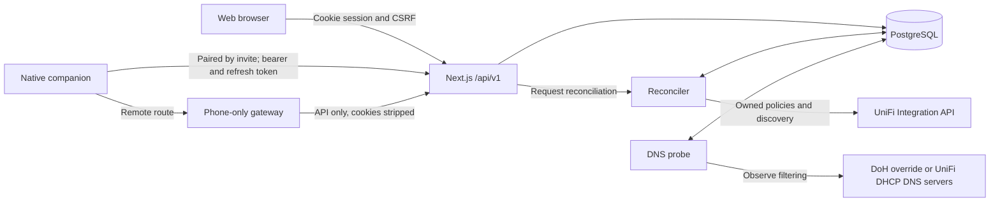

# Architecture

One Next.js App Router application serves the UI and `/api/v1`. All UniFi calls are server-side.
Read the system map, ownership, key flows and feature map first; the remaining sections explain
enforcement and DNS details. [Design system](design.md) owns design rules and [development conventions](development.md) coding
rules; [API guidance](api.md) owns the shared client contract.

## System map



The server owns durable household state and background work. Clients display that state and
request changes through the HTTP API. UniFi applies firewall policies; DNS probes independently
observe resolver behaviour. Neither a browser nor a native client gets a UniFi key or talks to
the gateway's management API.

```text
src/app          pages, layouts, api/v1 route handlers
src/components   web UI
src/ui           components shared with the native app (React Native, rendered on the web by react-native-web)
src/server       env, database, auth, schedule, UniFi, reconciliation
src/lib          client-safe constants, types, and pure logic (schedule windows)
prisma           PostgreSQL schema and migrations
openapi          versioned HTTP contract
docker           Dockerfile and Compose files
```

Desired household configuration lives in PostgreSQL. UniFi firewall policies are enforcement only. The application never modifies, disables, deletes, or reorders administrator-created policies, and never calls the policy ordering PUT endpoint.

## Ownership and data relationships

The exact fields and relations live in [schema.prisma](../prisma/schema.prisma). This is a conceptual
map, not a second schema: one deployment serves one household, including tables without a household
foreign key.

| Concept | Owns or relates to |
| --- | --- |
| `Household` | Gateway configuration, managed network scope, timezone, desired revision, resolver defaults and connection identity |
| `Group` → `Device` | Family/Things controls: pause and allowance, as the verbs on the built-in `internet` rule; each discovered network device has an optional group. Unassigned devices are quarantined. |
| `Account` → `Session` | Login identity and permissions. An account can link to a family group; group membership and authentication are separate concepts. |
| `PairedDevice` → `Session` | Paired apps (on phones, tablets and Macs), Watches and agents (with their scope, the account they act as, and the parent app of a Watch or of an app's Siri and shortcuts sign-in) and their device-bound sessions. This is distinct from a network `Device`, even if the same physical phone appears in both. |
| `ConnectionEndpoint`, `Pairing`, `DeviceEdgeToken` | Routes, one-time enrollment and delivery records for encrypted edge credentials; see [connection guidance](api.md#companion-connection-and-https) |
| `Rule` → `RuleGroup`, `RuleWindow`, `RulePolicy`; `Group` → `AppPolicy` | A household rule blocks all internet, a DPI category, apps or websites for one or more groups (or managed networks), always or in named windows; `RulePolicy` records one UniFi policy per window and zone. A group's `AppPolicy` is its pause policy, and app policies also represent quarantine. `PolicyOperation` records external write attempts and creation evidence. |
| `ChangeResult` → `SyncRun` | A requested revision and its outcome versus a reconciliation pass that may settle multiple requests. Actor account/device links attribute the request. |
| `UpstreamCategory` → `UpstreamDomain`, `UpstreamCheck` | Domain lists and observed DNS results. A check belongs to a category and resolver context; an optional group selects a group override. |

### Code boundaries

- [Route handlers](../src/app/api/v1) validate requests and apply [authentication guards](../src/server/guard.ts). Authorization is specified per method in the [authorization matrix](../tests/integration/authorization-matrix.test.ts).
- [src/server](../src/server) owns database access, secrets and external effects. [src/lib](../src/lib) holds client-safe types and logic; the [boundary test](../tests/unit/client-boundary.test.ts) checks transitive imports.
- The [household store](../src/lib/household-store.ts) owns shared household state and mutation feedback for every client; [AppDataProvider](../src/components/AppDataProvider.tsx) wraps it for the browser, and the native app wraps it in its own provider. Pages compose it with domain components; feature-specific data may have a page-owned lifecycle.
- [Reconciliation](../src/server/reconciliation.ts) coordinates enforcement. [Policy ownership](../src/server/unifi/policy-ownership.ts) guards all updates and deletes; planners and the UniFi client live under [src/server/unifi](../src/server/unifi).
- The [native repository](https://github.com/nickberardi/familyfi-mobile) owns its implementation and platform guidance. This repository owns the [HTTP and shared behaviour contract](api.md#shared-behaviour-and-consumer-adoption), not a copy of native screen status.

## Key flows

### Startup and reads

[Instrumentation](../src/instrumentation.ts) runs server initialization in the Node runtime outside
builds: it loads configuration, ensures recovery/household/seed data, starts reconciliation and DNS
scheduling, starts update checking, and resumes configured remote access. These are server process
responsibilities; visiting a page is not what starts enforcement.

The [household store](../src/lib/household-store.ts), through the browser's
[AppDataProvider](../src/components/AppDataProvider.tsx), reads the session, groups, devices,
rules, sync, gateway settings, household settings and accounts together. Every 15 seconds it rereads
what changes most on its own (groups, devices, rules and sync). Everything is reread every five
minutes, after a write's change is followed and whenever a refresh failed, so the gateway's status
and quarantine observation, which reconcile updates, can trail by up to five minutes on a page left
open. Showing the tab again runs the next refresh at once, unless one finished within the last 15
seconds. A read that brings nothing new keeps the previous references and
notifies no one, so pages do not render again. A hidden tab (or, natively, a backgrounded app passing
its own `Visibility`) sends nothing. Generation checks discard superseded reads. An unauthorized session redirects to login.
Initial read errors are shown; periodic refresh failures retain the previous data and mark it
`stale`, which the browser does not show. Do not interpret that retained snapshot as a fresh gateway
observation. A native client passes an offline guard instead: a stale view says so, and its
controls send nothing until a refresh succeeds.

### Pause from intent to feedback

1. The browser selects an action through [group-actions.ts](../src/components/group-actions.ts), and the shared [group-writes.ts](../src/lib/group-writes.ts) sends it through the store using [api.ts](../src/lib/api.ts), including the cookie session's CSRF header.
2. The [pause route](../src/app/api/v1/groups/[id]/rules/[ruleId]/pause/route.ts), called with the reserved rule id `internet`, checks authentication, request shape and group existence, then [runGroupInternet](../src/server/group-internet.ts) enables the group's built-in block rule in PostgreSQL.
3. [enqueueChange](../src/server/changes.ts) increments the household revision, creates a pending `ChangeResult` with actor attribution and requests reconciliation. The route returns the updated group and change reference. The group write and enqueue are separate operations; do not assume the entire path is one database transaction.
4. The browser applies the returned state through [household-state.ts](../src/lib/household-state.ts) and shows saved feedback. [mutate-gate.ts](../src/lib/mutate-gate.ts) prevents a superseded mutation response from replacing a newer one.
5. Reconciliation takes its database lock (renewed for as long as the pass runs), reads current desired state and writes only owned UniFi policies. A pause enables the group's built-in rule, whose one unscheduled block policy is planned like any rule's; resume switches the rule off and its policy is deleted. The run records outcomes and settles eligible changes; runs older than a week are deleted.
6. The browser polls this change's ID and reports applied, partial, failed or still pending, then refreshes. A polling failure leaves the saved state in place and reports a follow-up problem. A later global sync success is not proof that this particular request succeeded.

Evidence: [reconciliation tests](../tests/integration/reconcile.test.ts),
[reconciliation properties](../tests/integration/reconcile-properties.test.ts),
[household state tests](../tests/unit/household-state.test.ts),
[household store tests](../tests/unit/household-store.test.ts) and
[mutation ordering tests](../tests/unit/mutate-gate.test.ts).

### Pairing, sign-in and remote access

Every paired device joins through an invite (`/paired/invites`) and is managed through
`/paired/devices`. An administrator creates a one-time invite through the web Pair Device page,
choosing the adult the phone signs in as; the companion claims it and is signed in, with no
password. The code reaches the app as a QR, as text to paste, or, in a browser on a device the
app runs on, as a link in the app's own scheme (`src/lib/pairing-link.ts`); all three are the
same string, and the app confirms the household before it claims any of them. A code that carries a Cloudflare Access token is never offered as a link: a custom scheme belongs to whichever app registered it. The single-use claim in any other code accepts that risk: an app that registered the scheme first could claim it, which the Pair Device sheet would show as an unexpected device. A phone invites and claims its Watch itself (`?claim=true`). Pairing establishes both
device trust and the account the device acts as; the device's scope bounds what that session may
do, and the server checks it on each request. A Watch gets its own device identity and its
narrower `rulesOnly` scope. Only administrators sign in or have paired devices: an adult without
administrator access has no sign-in, session or device, and demoting one ends all three (see the
[invariant](../AGENTS.md#invariants)).

Remote routes reach the [phone-only gateway](../src/server/tunnel/phone-gateway.ts), which forwards
only API traffic, strips cookies and stamps tunnel provenance. The ordinary web UI is not exposed
through this path. [API connection guidance](api.md#companion-connection-and-https) explains identity,
signed manifests, pins and revocation. Evidence lives in the
[connection tests](../tests/integration/connection-api.test.ts),
[remote access tests](../tests/integration/remote-access.test.ts) and authorization matrix.

### Saved, applied and observed

| State or failure | Meaning for callers |
| --- | --- |
| Configuration saved | PostgreSQL holds the requested state. This alone makes no claim about UniFi. |
| Change applied | Reconciliation reports the desired policy state applied. This is not an end-to-end traffic measurement. |
| Partial, failed or pending change | Inspect that change and Sync. Preserve saved intent and expose the incomplete enforcement result. |
| UniFi unavailable | Discovery and enforcement cannot be confirmed; existing gateway policies may remain. A successful database write does not repair connectivity. |
| DNS observation | A configured DoH override or DHCP-discovered resolver answered a probe from the FamilyFi host. A device on another VLAN may receive a different answer. |
| DNS unavailable or never checked | Report `unknown`; do not infer open access or successful blocking. |
| Client request fails | Report the request failure. If the response was lost, the client cannot conclude from that alone whether the server saved the request. |

## Feature map

Web pages live under [src/app/(app)](../src/app/\(app\)). Use this map to find the owning area,
then read its callers and focused tests. Native feature details belong in its own repository.

| Web area | Responsibility | Implementation and test starting points |
| --- | --- | --- |
| Family and Things | Group cards and details (what they show and do is [Group states](group-states.md)), membership, the group's schedule and category marks | [GroupGrid](../src/components/GroupGrid.tsx), [GroupDetail](../src/components/GroupDetail.tsx) on the shared [src/ui](../src/ui) components ([GroupSchedule](../src/ui/GroupSchedule.tsx)) and their logic ([group-actions](../src/lib/group-actions.ts), [group-schedule](../src/lib/group-schedule.ts), [day-timeline](../src/lib/day-timeline.ts), [internet-zone](../src/lib/internet-zone.ts), [category-marks](../src/lib/category-marks.ts), [group-form](../src/lib/group-form.ts), [filter-sheet](../src/lib/filter-sheet.ts), [group-resolver](../src/lib/group-resolver.ts), [device-assign](../src/lib/device-assign.ts)), [group routes](../src/app/api/v1/groups), [group API tests](../tests/integration/group-detail-api.test.ts), [display vectors](../tests/unit/display-vectors.test.ts) |
| Devices / Unassigned | Discovery, assignment, quarantine and last observed connection details within managed networks. A device opens as its page (`/devices/<mac>`) on a phone and as a modal over the current page (`?device=<mac>`, [DeviceLink](../src/components/DeviceLink.tsx), [DeviceDetailModal](../src/components/DeviceDetailModal.tsx)) from `md` up | [devices](../src/server/devices.ts), [device-list](../src/lib/device-list.ts), [device-writes](../src/lib/device-writes.ts), [device-detail](../src/lib/device-detail.ts), [reconciliation](../src/server/reconciliation.ts), [quarantine tests](../tests/integration/quarantine-observe.test.ts) |
| Rules and group filter sheets | Household rules (internet, category, app, website), their windows, groups and UniFi policy names | [rules](../src/server/rules.ts), [rule planner](../src/server/unifi/plan-rules.ts), [rule editor](../src/components/rules/RuleEditor.tsx) on the shared [RuleEditorForm](../src/ui/RuleEditorForm.tsx) and its logic ([rule-list](../src/lib/rule-list.ts), [rule-editor](../src/lib/rule-editor.ts), [rule-catalog](../src/lib/rule-catalog.ts)), [rules API tests](../tests/integration/rules-api.test.ts), [DPI tests](../tests/integration/dpi-rules.test.ts) |
| Categories | Domain lists, resolver configuration and DNS observations | [probe](../src/server/upstream/probe.ts), [upstream-writes](../src/lib/upstream-writes.ts), [category API tests](../tests/integration/upstream-categories-api.test.ts), [browser tests](../tests/browser/categories.spec.ts) |
| Checkup | Recommended protection (the built-in Quarantine and Block countries rules' switches, and Block countries' own editor) and the network checkup: read-only checks over what sync reads plus the Wi-Fi networks (FamilyFi rules changed in UniFi and changed back, Sonos wired and on Wi-Fi, private Wi-Fi addresses, mDNS and Wi-Fi settings, networks handing out their own DNS, unmanaged networks), a newer FamilyFi release from the hourly release check (recorded when Checkup or `GET /sync` is read; it links to Settings' Maintenance install card), problems on the nav badge and notes that may be on purpose. Private addresses also show on Devices and a device's page or modal (folded behind How to fix there), and outside DNS in the rule editor. The official UniFi API cannot read STP mode, port STP settings or IGMP snooping, so the checkup cannot check the switch side of the Sonos advice. Block countries matches where a server is, not who owns it | [checkup](../src/lib/checkup.ts) and its [runner](../src/server/checkup.ts), [CheckupContent](../src/ui/CheckupContent.tsx), [PrivateAddress](../src/ui/PrivateAddress.tsx), [countries](../src/lib/countries.ts), [countries editor](../src/lib/countries-editor.ts), [checkup tests](../tests/unit/checkup.test.ts), [checkup API tests](../tests/integration/checkup-api.test.ts) |
| First-time setup | While a household has no gateway, `/`, `/login` and `/setup` open setup before sign-in: its first step hands over the admin password (masked, to copy) and continuing signs the browser in with it. It then walks through the gateway, the networks it watches, the people who live there and a few suggested schedules, each saved through the gateway, group and rule APIs | [setup page](../src/app/setup/page.tsx), [SetupFlow](../src/components/setup/SetupFlow.tsx), [SetupWizard](../src/components/setup/SetupWizard.tsx), [setup](../src/lib/setup.ts), [setup tests](../tests/unit/setup.test.ts), [redirect tests](../tests/integration/setup-redirect.test.ts), [write tests](../tests/integration/setup-writes.test.ts) |
| Settings | Gateway key/network scope, household settings, roles and logins | [gateway settings](../src/server/unifi-settings.ts), [accounts](../src/server/accounts.ts), [authorization matrix](../tests/integration/authorization-matrix.test.ts) |
| Diagnostics | Gateway load: each device's CPU, memory, load and uptime, and FamilyFi's own requests to the console | [gateway health](../src/server/gateway-health.ts), [request meter](../src/server/unifi/request-meter.ts) |
| Update | Release notes, installing a newer release through the Watchtower sidecar, now or on the household's schedule, and the last install's outcome | [updater](../src/server/updater.ts), [update check](../src/server/update-check.ts), [UpdateContent](../src/ui/UpdateContent.tsx), [UpdateScheduleCard](../src/ui/UpdateScheduleCard.tsx), [update-copy](../src/lib/update-copy.ts), [Compose service](../docker/docker-compose.yml), [backup hook](../scripts/runtime/pre-update-backup.sh), [update API tests](../tests/integration/update-api.test.ts), [operations](operations.md#automatic-updates) |
| Backup | Exporting the household to a `.tar.gz` and importing one, from Settings or first-time setup | [household-export](../src/server/household-export.ts), [archive](../src/server/archive.ts), [database-dump](../src/server/database-dump.ts), [BackupImport](../src/components/BackupImport.tsx), [export tests](../tests/integration/household-export.test.ts), [operations](operations.md#backup-and-restore) |
| Sync | Reconciliation history and per-change outcomes | [reconciliation](../src/server/reconciliation.ts), [changes](../src/server/changes.ts), [reconciliation path tests](../tests/integration/reconcile-paths.test.ts) |
| Pair Device | Companion pairing and remote connection management, and where to get the app (App Store and Google Play badges, set in `APP_STORES`) | [pairing](../src/server/pairing.ts), [pair-device](../src/lib/pair-device.ts) and [AppStoresCard](../src/components/pair/AppStoresCard.tsx), [paired devices](../src/server/paired-devices.ts), [connection](../src/server/connection.ts), [remote access](../src/server/tunnel/remote-access.ts), the companion client shared with phones ([pairing code](../src/lib/pairing-code.ts), [trust](../src/lib/companion-trust.ts), [requests](../src/lib/companion-request.ts), [pairing](../src/lib/companion-pairing.ts), [session](../src/lib/companion-session.ts), [connection hops and offline policy](../src/lib/connection-hops.ts), [Watch setup](../src/lib/watch.ts), [watch app words](../src/lib/watch-app-copy.ts)), [pairing browser tests](../tests/browser/pair.spec.ts), [companion tests](../tests/unit/companion-pairing.test.ts) |
| AI agents | Connect an agent from the Pair Device header: a prompt with an agent pairing code, the `/agents.md` guide, and the scope that bounds every paired device | [device scopes](../src/server/device-scope.ts), [connection](../src/server/connection.ts), [guide](../openapi/agent-guide.md), [agent tests](../tests/integration/agent-pairing.test.ts), [API docs](api.md#agents) |
| Modes and the in-memory database | `FAMILYFI_MODE` (`prod`, `dev`, `test`, `demo`) picks the gateway, database, data and lock; `DB_MODE=memory` and demo run on in-memory PGlite | [env](../src/server/env.ts) and its [startup copy](../scripts/runtime/mode.mjs), [launcher](../scripts/runtime/memory-database.mjs) and its [database server](../scripts/runtime/pglite-server.mjs), [mode tests](../tests/unit/familyfi-mode.test.ts), [setup](setup.md#modes) |
| Demo mode | The hosted public demo (`FAMILYFI_MODE=demo`): the seed household in memory, its public route, the locked configuration, the banner and the nightly reset | [demo](../src/server/demo.ts), [lock tests](../tests/integration/demo-lock.test.ts), [operations](operations.md#demo-mode), [boot test](../tests/unit/demo-boot.test.ts) |
| API reference | Authenticated interactive HTTP documentation | [OpenAPI](../openapi/familyfi.v1.yaml), [contract validation](testing.md) |

## Desired internet block

What each group request (pause, allow, unblock, a rule pause or allow, and their resume, extend and disallow) does on the gateway is specified in [Group states, 3.7](group-states.md#37-what-each-request-does-on-the-gateway), with what a card shows. The invariant on pauses in [AGENTS.md](../AGENTS.md#invariants) enforces it. This section covers the built-in rules and what limits enforcement.

Quarantined devices (null `groupId`) are desired-blocked independently of household rules, while `Household.quarantineEnforced` is on. Quarantine is also listed as the built-in rule `quarantine`: a `Rule` row created beside the household that holds only its pause. Its switch is `quarantineEnforced`, it never has `RulePolicy` rows, and while it is paused the quarantine `AppPolicy` policies are disabled in place, keeping their devices. It cannot be edited, deleted or allowed.

Lock DNS is the second built-in rule, `lock-dns`: an ordinary `Rule` row created off beside the household, whose groups or whole managed networks the household picks, as for any rule. On networks its policies take the networks as their source, as network-scoped rules do; if Settings stops managing all of them it goes back to people and things, off, and is never deleted. It never blocks the internet; it blocks the ways around the gateway's DNS, so website rules, which match the lookups the gateway sees, hold. Category and app rules match the traffic itself and don't depend on DNS. In each zone it has four always-on `RulePolicy` rows, keyed by part where a window id would be ([plan-rules.ts](../src/server/unifi/plan-rules.ts)): TCP and UDP 53 and 853 to the External zone (so the gateway and a DNS server on the home network still answer), the encrypted DNS services' IPv4 and IPv6 addresses (one policy per IP version), and their host names as a `DOMAIN` filter. The services are a seed shipped with each release ([encrypted-dns.ts](../src/lib/encrypted-dns.ts)); addresses go straight into the policy, so FamilyFi owns no traffic matching list. It leaves the household's own DNS alone ([lock-dns.ts](../src/server/unifi/lock-dns.ts)): the servers a managed network hands out by DHCP, unless on the home network itself, and the resolvers set in FamilyFi with the addresses their names resolve to (looked up at reconcile, remembered for an hour, never under the UniFi mock). The ports policy then blocks 53 and 853 to every address but those (an `IP_ADDRESS` filter with `matchOpposite` and a port filter), a service address or subnet holding one is left out of the address policies, and a resolver's name and the names above it are left out of the names policy; a part left with nothing to block has no policy. While a managed network's details cannot be read, its policies stay as they are and the pass is partial, so a missing server list never blocks the household's DNS. So a family that points its devices at a public filter, like Cloudflare for Families, keeps it. Each sync stores what it left open, named by where it comes from, on the rule (`openDns`), so its page lists it without a lookup. Its experimental Private Relay switch (`blockPrivateRelay`) adds a fifth policy that blocks Apple's relay names `mask.icloud.com` and `mask-h2.icloud.com` with a `DOMAIN` filter; Apple asks networks to fail those lookups, and an iPhone then turns iCloud Private Relay off for the network. Whether UniFi's domain filter fails the lookup rather than only the connection is unproven, hence experimental. It is paused and allowed like any rule. A device set to a private DNS host name (Android Private DNS) loses its internet until set back to automatic.

Timed pause and allowance expiry are the only clock-driven writes; membership and quarantine still go through reconciliation.

Discovery and quarantine only include clients whose UniFi **network (VLAN)** is in the household allowlist (`manageAllNetworks` or `managedNetworkIds`). New devices on other VLANs are not ingested and are not added to quarantine policies. Assigned devices that roam off a managed network are left out of FamilyFi policies until they return. UniFi still applies a MAC policy to every VLAN that shares that **firewall zone**; pick networks whose zones match what you want to enforce.

An unassigned device the gateway has not listed for 30 days is forgotten on the next pass, so phones that rotate their private address do not grow the device list (and every poll of it) forever; if it comes back it is discovered again, quarantined. A device in a group is never forgotten.

Days identify the local weekday a window starts. Windows are half-open. Evaluation uses the household IANA timezone and local wall time, including both occurrences of a repeated DST time. UniFi uses the console clock for native schedules; household timezone vs console timezone must be aligned or documented.

## Reconciliation

Each pass also leaves what Settings shows from the gateway, so the routes every open page polls never ask the console themselves: the site's networks, kept in memory for `GET /settings/unifi` (read from the console only when no pass has in the last two minutes), and each quarantine policy's `observedEnabled`, which `GET /settings/household` reports. Every request the server sends the console is counted by endpoint ([request-meter.ts](../src/server/unifi/request-meter.ts)); the server logs a summary every five minutes while there is traffic, and **Gateway load**, on the Diagnostics page, shows it beside each device's latest CPU, memory, load and uptime, gateway first ([gateway-device.ts](../src/server/unifi/gateway-device.ts): the device the console gives the `gateway` feature; else the one whose `ipAddress` is the gateway's `hostIpAddress` on any network, then the console's address in the integration URL; at worst a gateway model) (`GET /health?gateway=true`, which takes a session and is asked only when that page opens or on Check now; the plain `/health` others poll never reaches the console). A console with a self-signed certificate is reached over one kept-alive connection pool, not a TLS handshake per request.

A database-backed lock serializes startup, interval (~30s), and mutation-triggered runs. Overlapping writers, including container replacement, must not apply stale revisions. A pass renews only the lock it still holds, never one that lapsed, since another pass may have taken and released it in the gap. A pass that finds its lock gone stops before its next gateway write and before settling changes, which it leaves for the pass that took over. This fencing is best-effort: a gateway write already in flight still finishes. Interval work is discovery, membership, and pause and allowance expiry — not window start/end. Until a UniFi key is saved in Settings, reconciliation is a no-op.

A successful connected-client read marks observed devices online and previously known absent devices offline, preserving their last-seen time. It also records UniFi's connection start and wired/wireless type. One site-device read per pass resolves a wireless uplink to an access point name. The pass also records each device's IEEE MAC registrant from `src/server/mac-registrants.sqlite`, a committed, indexed snapshot that `scripts/update-mac-vendors.py` rebuilds on request and that records its source hashes. Only reconciliation opens it, read-only, so requests never load it; if it cannot be read, the last recorded manufacturer stays. A failed client read leaves the previous observation intact; API responses label observations older than 90 seconds as last known. These are observations, not traffic measurements.

Each pass reads the gateway's policy list. A recorded FamilyFi policy that is no longer there (someone deleted it on the console) is created again on that pass, even if nothing about its group changed; a stale record whose policy is already gone is simply cleared. A policy FamilyFi created on this console and site (an applied create operation) that no `AppPolicy` or `RulePolicy` record points at any more is deleted — that is what a failed UniFi delete during a rule, group or console change leaves behind. Its creation record is the evidence it is ours, never its name. The sweep covers only the current console and site, so saving a connection to a different one first deletes every policy FamilyFi owns on the old one (quarantine, rule and unclaimed created policies; one already gone counts as deleted) and drops those records; a create there whose answer was lost is matched first, so its policy goes too. The save holds the reconcile lock throughout, waiting up to a minute for a running pass, so no pass writes to the old console or records a policy there meanwhile, and it checks the network choice against the new site before touching the old one. If a delete fails (the old gateway is unreachable or refuses), the connection is left unchanged and the save answers `previous_gateway_unreachable`; the operator can then forget the old gateway (`forgetPrevious`), which drops its records without deleting anything there, so its FamilyFi policies stay on that console unclaimed.

A recorded policy someone **changed on the console** is changed back. When the gateway's copy of a policy FamilyFi last confirmed no longer carries FamilyFi's write (its switch, devices, schedule, name or anything else the write set), the pass records what differed on the row (`gatewayDrift`, `driftSeenAt`; device lists as MAC addresses) and writes FamilyFi's version back ([drift.ts](../src/server/unifi/drift.ts)). A policy whose last write failed, or that FamilyFi has not yet confirmed, differs because of FamilyFi, so it is not drift; FamilyFi changing the policy itself clears the record. After every pass Checkup's `gateway_drift` note shows, one per rule, what was changed and whether it was put back; it goes a week after the change was last seen. While writing it back fails, the note offers **Put it back**, which asks for a pass now.

Checkup lists **leftover policies**: policies on this console and site named with FamilyFi's prefix that no record claims (not an `AppPolicy` or `RulePolicy`, not an applied create, and not one a pending create may have made). An earlier install, a reset database or a forgotten gateway leaves them, and sync never touches them. The name only decides what Checkup offers; FamilyFi deletes one only when an administrator ticks it and confirms (`POST /api/v1/checkup/leftover-policies/remove`). That route checks each policy against the gateway again, records the confirmation as a `delete` `PolicyOperation` with status `confirmed`, and only then deletes it. The removal holds the reconcile lock. The ownership guard allows that single delete, for two minutes and never as an update, and the record becomes `removed` once the policy is gone or `failed` if the gateway refuses; every sync pass fails a confirmation a stopped removal left behind before it writes (`src/server/leftover-policies.ts`).

A create whose answer was lost (a timeout, a dropped connection, or a 5xx a proxy may have sent after the gateway committed it) stays a pending operation; only a 4xx marks it failed. Each pass matches pending creates to policies on the gateway that no record claims and that carry the whole write the create sent, which the operation records: every field it set, with the same value, whatever key or list order and defaults the gateway answers with. A match is recorded as that create's policy. When the same pass would create that very write again (an always-on write takes only a policy with no schedule), it takes the matched policy as the record's instead, so the policy that already enforces is never deleted in favour of a create the gateway might refuse; any other match is unclaimed and the orphan sweep deletes it, so a lost answer never leaves a duplicate enforcing. An operation's stored write is cleared once it is applied or failed. Never by name or `FamilyFi ` prefix alone. A pending create still unmatched ten minutes later made nothing, and is marked failed; pending creates are never pruned. Do not delete administrator rules to recover. Every UniFi client the app hands out (`clientForHousehold`, and the fixture client tests inject into reconcile) refuses to update or delete a policy whose id is not on record for the current console and site: an `AppPolicy` or `RulePolicy` row, or an applied create operation. During reconcile the refusal is recorded as that policy's error and shows on Sync.

## UniFi client

`src/server/unifi` talks to the official Network Integration API (contract v10.4.57; live Network 10.6.106) with `X-API-KEY`. Pagination uses limit 200. Internet-block policies use firewall action `BLOCK` (live check: more effective than `REJECT` on this gateway). Policy enable/disable is PUT of the full write body. PATCH is logging-only. The client refuses PUT on policy ordering. `GET` ordering on this console requires `sourceFirewallZoneId`.

Integration bases:

- Local: `https://<console-ip>/proxy/network/integration` then `/v1/...`. A bare hostname is not an integration base.
- Cloud: `https://api.ui.com/v1/connector/consoles/{consoleId}/proxy/network/integration` (not live-tested).

Official client overview/details do not include `networkId`. Mapping:

1. `GET /v1/sites/{siteId}/networks/{networkId}/references` `CLIENT` `referenceId`s
2. Else match `client.ipAddress` to gateway network `ipv4Configuration.hostIpAddress` + `prefixLength` (and `additionalHostIpSubnets`)
3. Zone via `network.zoneId` and/or `zone.networkIds`

Destination zone: first of External, WAN, Internet (case-insensitive). Source: one policy per source zone, and per window of a rule. A rule's policies are named `FamilyFi <rule name>`, with ` – <window name>` once it has more than one window and ` (<zone>)` outside the Internal zone, clipped to UniFi's 100 characters ([policy-names.ts](../src/lib/policy-names.ts)); a rename is a PUT of the same policy. Website rules use a `DOMAIN` destination filter (`domainFilter: { type: "DOMAINS", domains }`), which the gateway matches from DNS lookups, so a device using its own DNS can get around it unless Lock DNS covers its group. That payload shape comes from the issue that asked for it (#94) and is not yet proven against a gateway. IP scope: `IPV4_AND_IPV6` with no protocol filter, except Lock DNS's DNS ports policy (`TCP_UDP`) and its address policies (`IPV4` or `IPV6`). Lock DNS's `PORT` and `IP_ADDRESS` destination filters follow the Network API 11.0.94 schema and are not yet proven against a gateway. IPv6 blocking, overnight UniFi scheduler windows, and a second concurrent MAC are unproven; do not claim dual-stack blocking.

### Curated category slots

`src/server/unifi/curated-categories.ts` maps five parent-facing slots onto confirmed
integer DPI category ids: Video (4), Social (24), Gaming (8), VPN (11) and Messaging (0).
`src/lib/rules.ts` mirrors that table for the browser and a unit test asserts the two
cannot drift. Only ids go into a policy body; `catalogName` is the console's own name for
that id and exists for docs and UI. Adult is deliberately not a slot, though the full
catalog still lists it for an arbitrary id pick.

Video, Social and Gaming were read off a household console. VPN and Messaging were added
against a catalog dump of Network 10.6.106 whose ids 4 / 8 / 22 / 24 / 28 reproduce the
already-confirmed map and the fixture's names exactly; that agreement on known ids is
what promotes the two new ones. Messaging is category 0 alone — the catalog also carries
15 "Web instant messengers", but it holds three obscure regional clients and a slot maps
to one id.

**Messaging's id is zero, so nothing on this path may test a target id for truthiness.**
Rule validation is `nonnegative`, not `positive`, and `normalizeTargetIds` filters on
`>= 0`. Both were `> 0` and silently turned a Messaging rule into an empty target list.
An integration test walks the id from the API through to the policy body.

Every curated slot also has a domain list of the same slug behind it in
`src/lib/upstream-domains.ts`, which is what lets its mark report a DNS verdict when no
policy is blocking; a unit test holds that pairing.

Mocks and fixtures do not prove enforcement. `FAMILYFI_MODE` `dev`, `test` and `demo` route Settings and reconciliation through `MockUnifiClient` plus a dummy household seed so the UI can be exercised without a console; production starts only `prod` and `demo` ([modes](setup.md#modes)).

## Upstream DNS categories

A second, independent signal: domain lists resolved through the DNS servers UniFi DHCP gives
managed networks, or a DoH override. **Reporting only**: nothing here touches a UniFi policy or
enqueues reconciliation. How verdicts, the seed, the schedule, resolvers, category marks and the
DNS wire format work is [DNS categories](dns-categories.md).

## Secrets

Personal passwords are Argon2id hashes. The UniFi API key is AES-256-GCM encrypted with `FAMILYFI_ENCRYPTION_KEY`. The DoH endpoint is **not** encrypted and is returned in full. A resolver URL is configuration, not a credential: a profile id in its path lets someone spend that profile's quota and appear in its logs, but not read those logs or change a setting, and a single-household deployment has no lesser-privileged reader to hide it from. Encrypting it put DNS checking inside the blast radius of an encryption-key rotation and left a mistyped endpoint invisible behind an unknown verdict. Treat it like the rest of the household config — keep it out of pasted dumps. The recovery admin password is never stored in the database; it is compared to `FAMILYFI_DEFAULT_PASSWORD` and printed in the server log at startup so an operator can find it. It is never returned by the API. Until the household saves a gateway key, the first-time setup page hands it to whoever opens FamilyFi, so a new install signs in without reading the log; once a key is saved the page never carries it again.
