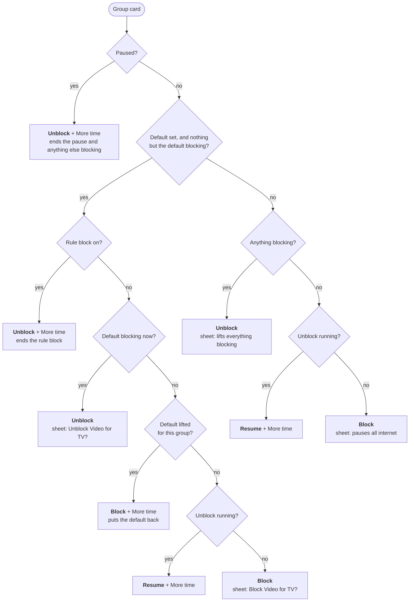

# Group states

What a group card shows and what its button does. Read this before changing a group's badge,
status line, Block/Unblock button, More time link or dropdown on any client. It has three parts:

1. **User stories**: what a parent needs from the card.
2. **Design**: the state a group can be in, what the card shows, and a diagram of how the button
   decides what to do.
3. **Spec**: the exact rules, followed by examples that have been checked against the code.

If the code and this file disagree, one of them is a bug. Fix it, or change both in the same commit.

## 1. User stories

The user is a parent who is an administrator, glancing at the card for a few seconds. In the
examples, the TV group has **Video** and **Social** blocked all day, and **Gaming** blocked 10 AM to
12 PM. Sam is the parent.

| # | As a parent, I want to… | So that… | Acceptance (TV example) |
| --- | --- | --- | --- |
| 1 | see at a glance whether a group has the internet | I know if my kid is online | The badge reads **Blocked** only when the internet is off. TV with Video blocked all day reads **Online**. |
| 2 | block all internet now, for a while or until I say | I can cut it off quickly | With nothing blocking, the button reads **Block**. It opens a sheet, then pauses all internet. The badge becomes Blocked. |
| 3 | unblock with one tap whatever is blocking now, for this group only | I don't have to work out which rule is responsible | At 11 AM the button reads **Unblock**. It lifts Gaming for TV until a time I pick. Gaming still applies to every other group. |
| 4 | go back to normal, or give more time | an unblock or block ends when I choose | After an unblock the button reads **Resume**, which puts the rules back at once. **More time** extends whatever is timed. |
| 5 | have all-day rules treated as setup, not as a block | a TV that never gets Social doesn't read "blocked" all day | At 9 AM with no default, TV reads Online and the button reads **Block** (all internet). Unblock never lifts Video or Social. |
| 6 | choose one all-day rule that the card's button controls | I can let the TV play video tonight without switching the rule off for everyone | With Video as the **Block button default**: at 9 AM the button reads **Unblock** and opens "Unblock Video for TV?". After an hour's unblock it reads **Block** + More time, and Block puts Video back at once. |
| 7 | still clear everything with one Unblock when a default is set | the default never hides other blocks | With Video as default, at 11 AM Unblock lifts Video and Gaming together. Social stays. |
| 8 | block the default rule now, outside its schedule | I can stop video early tonight | With Video scheduled 7 to 9 PM as the default, at 3 PM the button reads **Block** and opens "Block Video for TV?". The line reads "Video blocked until 5:00 PM by Sam", the badge stays Online, and Unblock ends it at once. |
| 9 | keep blocking all internet one tap away when a default is set | the default doesn't take that away | The dropdown shows **Block internet**. |
| 10 | have a button I can always read the same way | I never have to wonder what it does | The button only ever reads **Block**, **Unblock** or **Resume**. It never names a rule. Only the sheets and the status line name one. |
| 11 | have Siri and the Control Center / Quick Settings switch agree with the badge | "Block TV" means the internet | Siri's Block and the switch pause all internet. Siri's Unblock is the same as the card's Unblock (story 3), so it lifts the default too. |

## 2. Design

### The state a group can be in

| Element | Meaning | Set by | Field |
| --- | --- | --- | --- |
| **Internet rule** | Blocks all internet, in windows or always. | Rules page | `Rule.kind: "internet"` |
| **Scheduled rule** | A category, app or website rule that blocks only in its windows. | Rules page | `kind` ≠ internet, `mode: "scheduled"` |
| **All-day rule** | A category, app or website rule that is always on. It is how the group is set up. | Rules page | `kind` ≠ internet, `mode: "always"` (`standingRule`) |
| **Block button default** | One of the group's own category, app or website rules, picked so the button controls it. Optional. | Group's Edit sheet | `Group.blockButtonRuleId`, read through `blockButtonRule()` |
| **Pause** | The group's own block of all internet. | Block | `Group.suspension` |
| **Rule block** | The group's own block of the default rule, whatever that rule's schedule says. It shares one hidden rule with the pause, so only one of the two can be on. | Block, with a default | `Group.ruleBlock` |
| **Unblock** | Every rule that was blocking is lifted for this group, until a time. They are put back together. | Unblock | `groupPauses` entries of kind `allow` |
| **Rule lift** | One rule is lifted for this group, until a time. | The dropdown's Unblock <rule>, or Unblock on the default | `groupPauses` entries of kind `pause` |

A rule that is switched off or paused for everyone does not apply to any group, so it is ignored
here.

### What the card shows

| Output | The question it answers |
| --- | --- |
| **Badge** | Does the group have the internet? (Blocked or Online) |
| **Status line** | Why it is in that state, and until when. Red means someone blocked the group, green means someone unblocked it, and grey means the rules are running as set up. |
| **Button** | The one thing a parent most likely wants to do next: Block, Unblock or Resume. |
| **More time** | Extends whatever is timed. |
| **Dropdown** | Every other choice: Block internet, Unblock <rule>, and Block <rule> again. |

### How the button decides

"Blocking" means a rule that counts as blocking now (spec 3.1). An all-day rule counts only when it
is the default.

## 3. Spec

Code: `src/lib/group-actions.ts` (`rulesToUnblock`, `groupHeaderActions`, `groupMenu`,
`groupStatusParts`), `src/lib/group-writes.ts` (`runGroupCardAction`), and on the server
`src/server/group-unblock.ts`, `group-internet.ts` and `group-rule-block.ts`. Every case is a vector
in `tests/fixtures/display-vectors.json`, which the web, the app, the Apple Watch (`Display.swift`)
and Wear OS (`Display.kt`) all replay. Change the spec, the code and the vectors together, then port
the change to both watches.

### 3.1 Blocking

A rule is **blocking** a group when all of these hold:

- it covers the group, is enabled, and is not paused for everyone;
- it is not lifted for the group (no unblock and no rule lift);
- one of its windows is active now (an always-on rule's window always is);
- it is not an all-day rule, **unless** it is the default.

In code this is `rulesToUnblock(G)`. The pause and the rule block are not rules in this list; they are
read from the group.

### 3.2 Badge

**Blocked** when the group is paused or an internet rule is blocking. **Online** in every other
case, including a rule block or a blocking category rule. The Block switch outside the app is on
exactly when the badge reads Blocked.

### 3.3 Button

This is the diagram above, as a table. The first matching row wins.

| # | When | Button | Request |
| --- | --- | --- | --- |
| A | Paused | Unblock (+ More time if timed) | Sheet, `POST /groups/{id}/unblock`. If nothing else is blocking, that request is sent at once. |
| B1 | Default set and nothing else blocking, and the rule block is on | Unblock (+ More time if timed) | At once, `POST /groups/{id}/rules/{default}/block/end` |
| B2 | …, and the default is blocking | Unblock | Sheet, `POST /groups/{id}/rules/{default}/pause` (a rule lift) |
| B3 | …, and the default has a rule lift | Block (+ More time if timed) | At once, `POST /groups/{id}/rules/{default}/resume` |
| B4 | …, and an unblock is running | Resume (+ More time if timed) | At once, `POST /groups/{id}/unblock/end` |
| B5 | …, otherwise | Block | Sheet, `POST /groups/{id}/rules/{default}/block` |
| C | The rule block is on for a rule that is no longer the default, and nothing is blocking | Unblock | At once, `.../rules/{that rule}/block/end`. This is a fallback: changing the default already ends the old block. |
| D | Anything blocking | Unblock | Sheet, `POST /groups/{id}/unblock` |
| E | An unblock is running | Resume (+ More time if timed) | At once, `POST /groups/{id}/unblock/end` |
| F | Otherwise | Block | Sheet, `POST /groups/{id}/rules/internet/pause` |

Every request sent at once is followed by a notice with Undo.

**What Unblock lifts** (`runGroupUnblock`) is each rule covering the group that is blocking now, by
3.1, each until its window ends. If the parent picks a time, each of them is lifted until that time
instead. It also ends the pause or the rule block. It never lifts:

- an all-day rule that is not the default;
- a rule that already has a rule lift;
- Lock DNS or Block countries.

If there is nothing to lift, it answers 409 `not_blocked`.

### 3.4 Dropdown

The dropdown appears while the button acts on the default (rows B and C), or while a category, app
or website rule other than the button's is blocking or lifted for the group. It counts all-day rules
here. It lists:

1. **Block internet**, unless the internet is already blocked, or the button is already Block for
   all internet (row F).
2. **Unblock <rule>** for each rule blocking now, all-day rules included: internet rules first, then
   scheduled rules, then all-day rules. Each one lifts only that rule. It leaves out the button's own
   rule. It also leaves out the single scheduled rule that the button's Unblock lifts on its own
   (row D with exactly one scheduled rule blocking).
3. **Block <rule> again** for each rule with a rule lift, other than the button's rule.

### 3.5 Status line

The first matching case wins.

| # | When | Line | Colour |
| --- | --- | --- | --- |
| 1 | Paused | "Until 6:00 PM by Sam" / "Until you unblock, by Sam" | red |
| 2 | An internet rule is blocking | "Dinner until 8:00 PM" / "Dinner · always" | grey |
| 3 | The rule block is on | "Video blocked until 5:00 PM by Sam" / "Video blocked by Sam until you unblock" | red |
| 4 | Anything is blocking | "Gaming blocked until 12:00 PM". Several rules are joined as "Video and Gaming blocked", with the latest end time, and with no time when one never ends. | grey |
| 5 | The default has a rule lift | "Video unblocked until 10:00 AM by Sam" / "… until you block it again" | green |
| 6 | An unblock is running | "Unblocked until 12:00 PM by Sam" | green |
| 7 | An internet rule is paused for this group or for everyone | "Internet rule paused until …" | green |
| 8 | Otherwise | The next internet window ("Dinner at 6:00 PM"), or "No internet rule". With a default and no internet rule: "Video at 7:00 PM" if the default blocks within a day, otherwise "Video not blocked". | grey |

The default is named by its category ("Video") when that is all it blocks, and by the rule's own
name otherwise.

### 3.6 Examples (checked against `groupHeaderActions` and `groupStatusParts`)

The TV group from section 1.

| Default | Time and state | Badge | Line | Button (row) | Dropdown |
| --- | --- | --- | --- | --- | --- |
| none | 9 AM | Online | No internet rule | Block (F) | Unblock Video, Unblock Social |
| none | 9 AM, paused until 6 PM | Blocked | Until 6:00 PM by Sam | Unblock + More time (A) | Unblock Video, Unblock Social |
| none | 11 AM | Online | Gaming blocked until 12:00 PM | Unblock (D) | Block internet, Unblock Video, Unblock Social |
| none | 11 AM, unblocked | Online | Unblocked until 12:00 PM by Sam | Resume + More time (E) | Block internet, Unblock Video, Unblock Social |
| Video | 9 AM | Online | Video blocked | Unblock (B2) | Block internet, Unblock Social |
| Video | 9 AM, Video lifted for an hour | Online | Video unblocked until 10:00 AM by Sam | Block + More time (B3) | Block internet, Unblock Social |
| Video | 11 AM | Online | Video and Gaming blocked | Unblock (D) | Block internet, Unblock Video, Unblock Social |
| Video | 11 AM, Video already lifted | Online | Gaming blocked until 12:00 PM | Unblock (D) | Block internet, Unblock Social, Block Video again |
| Video, scheduled 7 to 9 PM | 3 PM | Online | Video at 7:00 PM | Block (B5) | Block internet |
| Video, scheduled 7 to 9 PM | 3 PM, rule block until 5 PM | Online | Video blocked until 5:00 PM by Sam | Unblock + More time (B1) | Block internet |
