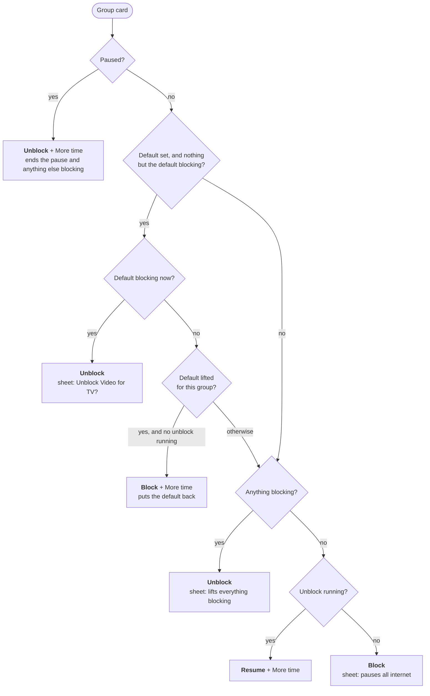

# Group states

What a group card shows and what its button does. Read this before changing a group's badge,
status line, Block/Unblock button, More time link, ask line or dropdown on any client. It has three parts:

1. **User stories**: what a parent needs from the card.
2. **Design**: the state a group can be in, what the card shows, and a diagram of how the button
   decides what to do.
3. **Spec**: the exact rules, examples that have been checked against the code, and what each
   request does on the gateway.

If the code and this file disagree, one of them is a bug. Fix it, or change both in the same commit.

## 1. User stories

The user is a parent who is an administrator, glancing at the card for a few seconds. In the
examples, the TV group has **Video** and **Social** blocked all day, and **Gaming** blocked 10 AM to
12 PM. Sam is the parent.

| # | As a parent, I want to… | So that… | Acceptance (TV example) |
| --- | --- | --- | --- |
| 1 | see at a glance whether a group has the internet, or, with a default, whether its default rule is on | I know if my kid is online, or if the TV can play video | With no default the badge reads **Blocked** only when the internet is off: TV with Video blocked all day reads **Online**. With Video as the default the badge follows Video: **Blocked** while it blocks, **Unblocked** while it is lifted for TV, **Online** otherwise. |
| 2 | block all internet now, for a while or until I say | I can cut it off quickly | With nothing blocking, the button reads **Block**. It opens a sheet, then pauses all internet. The badge becomes Blocked. |
| 3 | unblock with one tap whatever is blocking now, for this group only | I don't have to work out which rule is responsible | At 11 AM the button reads **Unblock**. Its sheet's first choice lifts Gaming for TV until Gaming's window ends. A chosen time (For… or Until…) lifts all of TV's rules until then, except Video and Social. Gaming still applies to every other group. |
| 4 | go back to normal, or give more time | an unblock or block ends when I choose | After an unblock that lifted rules, the button reads **Resume**, which puts them back at once. (Unblocking a pause with nothing else blocking just ends the pause, so the button reads Block.) **More time** extends whatever is timed. |
| 5 | have all-day rules treated as setup, not as a block | a TV that never gets Social doesn't read "blocked" all day | At 9 AM with no default, TV reads Online and the button reads **Block** (all internet). Unblock never lifts Video or Social. |
| 6 | choose one all-day rule that the card's button controls | I can let the TV play video tonight without switching the rule off for everyone | With Video as the **Block button default**: at 9 AM the button reads **Unblock** and opens "Unblock Video for TV?". After an hour's unblock it reads **Block** + More time, and Block puts Video back at once. |
| 7 | still clear everything with one Unblock when a default is set | the default never hides other blocks | With Video as default, at 11 AM Unblock lifts Video and Gaming together. Social stays. |
| 8 | have Block still mean all internet when the default isn't blocking | the button never does nothing | With Video scheduled 7 to 9 PM as the default, at 3 PM the button reads **Block** and pauses all internet, as with no default. The line says when Video blocks next ("Video at 7:00 PM"). |
| 9 | keep blocking all internet one tap away when a default is set | the default doesn't take that away | The dropdown shows **Block internet**. |
| 10 | have a button I can always read the same way | I never have to wonder what it does | The button only ever reads **Block**, **Unblock** or **Resume**. It never names a rule. Only the sheets and the status line name one. |
| 11 | have Siri and the Control Center / Quick Settings switch mean the internet | "Block TV" means the internet | Siri's Block and turning the switch on pause all internet. Siri's Unblock and turning the switch off send the group unblock with no time (`POST /groups/{id}/unblock`), so they lift the default too. Unlike the card's B1, this is an unblock, so the card then reads Resume. When nothing can be lifted, Siri offers to lift one all-day rule for a while. The switch is on exactly when the internet is off (the badge without a default), whatever the default does. |

## 2. Design

### The state a group can be in

| Element | Meaning | Set by | Field |
| --- | --- | --- | --- |
| **Internet rule** | Blocks all internet, in windows or always. | Rules page | `Rule.kind: "internet"` |
| **Scheduled rule** | A category, app or website rule that blocks only in its windows. | Rules page | `kind` ≠ internet, `mode: "scheduled"` |
| **All-day rule** | A category, app or website rule that is always on. It is how the group is set up. | Rules page | `kind` ≠ internet, `mode: "always"` (`standingRule`) |
| **Block button default** | One of the group's own category, app or website rules, picked so the button controls it. Optional. | Group's Edit sheet | `Group.blockButtonRuleId`, read through `blockButtonRule()` |
| **Pause** | The group's own block of all internet. | Block | `Group.suspension` |
| **Unblock** | Every rule that was blocking is lifted for this group, until a time. They are put back together. | Unblock | `groupPauses` entries of kind `allow` |
| **Rule lift** | One rule is lifted for this group, until a time. | The dropdown's Unblock <rule>, or Unblock on the default | `groupPauses` entries of kind `pause` |

A rule that is switched off or paused for everyone does not block any group, so it is not
blocking (3.1). An internet rule paused for everyone is still reported on the status line (3.5
case 6).

### What the card shows

| Output | The question it answers |
| --- | --- |
| **Badge** | Does the group have the internet? (Blocked or Online.) With a default: is that rule on? (Blocked, Unblocked or Online.) |
| **Status line** | Why it is in that state, and until when. Red means someone blocked the group, green means someone unblocked it, and grey means the rules are running as set up. |
| **Button** | The one thing a parent most likely wants to do next: Block, Unblock or Resume. |
| **More time** | Extends whatever is timed. |
| **Dropdown** | Every other choice: Block internet, Unblock <rule>, and Block <rule> again. |
| **Ask line** | A child's phone (FamilyFi Me) is waiting for an answer: "Asked to be unpaused", "Asked for 30 minutes off Bedtime". It opens the answer sheet. |

### How the button decides

"Blocking" means a rule that counts as blocking now (spec 3.1). An all-day rule counts only when it
is the default. "More time" shows only when what it extends has an end time.

## 3. Spec

Code: `src/lib/group-actions.ts` (`rulesToUnblock`, `groupHeaderActions`, `groupMenu`,
`groupStatusParts`), `src/lib/group-writes.ts` (`runGroupCardAction`), and on the server
`src/server/group-unblock.ts` and `group-internet.ts`. These functions are
tested through the vectors in `tests/fixtures/display-vectors.json`, which the web, the app, the
Apple Watch (`Display.swift`) and Wear OS (`Display.kt`) all replay. Add a case there, not a separate
test. Change the spec, the code and the vectors together, then port
the change to both watches.

### 3.1 Blocking

A rule is **blocking** a group when all of these hold:

- it covers the group, is enabled, is not built in (Lock DNS, Block countries, quarantine), and is
  not paused for everyone;
- it is not lifted for the group (no unblock and no rule lift);
- one of its windows is active now (an always-on rule's window always is);
- it is not an all-day rule, **unless** it is the default.

In code this is `rulesToUnblock(G)`. The pause is not a rule in this list; it is read from the
group.

### 3.2 Badge

**Blocked** when the group is paused or an internet rule is blocking. With a default, also
**Blocked** while the default is blocking (it is in 3.1's list), and **Unblocked** (green) while the
default is lifted for the group, by its own rule lift or the group's unblock. **Online** in every
other case, including while a category rule other than the default blocks. (The code has one more path: the status
line's fallback, 3.5 case 7, reads Blocked for an internet window that 3.1 skipped. Only a built-in
internet rule covering the group could reach it, and none does today.) The Block switch outside the app is on
exactly when the group is paused or an internet rule is blocking, so a default blocking never turns it on.

### 3.3 Button

This is the diagram above, as a table. The first matching row wins.

| # | When | Button | Request |
| --- | --- | --- | --- |
| A | Paused | Unblock (+ More time if timed) | Sheet, `POST /groups/{id}/unblock`. If nothing else is blocking, that request is sent at once. |
| B1 | A default is set, nothing but the default is blocking, and the default is blocking | Unblock | Sheet "Unblock Video for TV?", `POST /groups/{id}/rules/{default}/pause` (a rule lift) |
| B2 | A default is set, nothing is blocking, the default has a rule lift, and no unblock is running | Block (+ More time if timed) | At once, `POST /groups/{id}/rules/{default}/resume` |
| C | Anything blocking | Unblock | Sheet, `POST /groups/{id}/unblock` |
| D | An unblock is running | Resume (+ More time if timed) | At once, `POST /groups/{id}/unblock/end` |
| E | Otherwise | Block | Sheet, `POST /groups/{id}/rules/internet/pause` |

With a default set, rows B1 and B2 are the only difference. Every other state falls through to C, D
or E as if there were no default, so Block always means all internet.

A request from a sheet, and B2, are followed by a notice with Undo. Row A's at-once request and
Resume (D) show "Saved." with no Undo.

**What Unblock lifts** (`unblockGroup`). A rule covering the group is a candidate unless it is:

- switched off or paused for everyone;
- an all-day rule that is not the default;
- already rule-lifted for the group;
- Lock DNS or Block countries.

A rule the group has already unblocked stays a candidate, so its time is renewed.

- **With no time** (the sheet's first choice, Siri, and the switch), it lifts each candidate whose
  window is active now, until that window ends.
- **With a time**, it lifts every candidate until then, including scheduled rules whose window has not
  started yet.

It also ends the pause. It answers 409 `not_blocked` only when there is no candidate to lift and
the group isn't paused.

### 3.4 Dropdown

The dropdown appears while the button acts on the default (rows B1 and B2), or while a
category, app or website rule other than the button's is blocking or lifted for the group. Here
"blocking" includes all-day rules. It lists:

1. **Block internet**, unless the internet is already blocked, or the button is already Block for
   all internet (row E).
2. **Unblock <rule>** for each rule blocking now, all-day rules included: internet rules first, then
   scheduled rules, then all-day rules (the default among them). Each one lifts only that rule.
   Two rules are left out: the button's own rule, and, when the button's Unblock (row C)
   would lift exactly one rule, that rule, since the button already does it.
3. **Block <rule> again** for each rule with a rule lift, other than the button's rule.

### 3.5 Status line

The first matching case wins.

| # | When | Line | Colour |
| --- | --- | --- | --- |
| 1 | Paused | "Until 6:00 PM by Sam" / "Until you unblock, by Sam" | red |
| 2 | An internet rule is blocking | "Dinner until 8:00 PM" / "Dinner · always" | grey |
| 3 | Anything is blocking | "Gaming blocked until 12:00 PM". Several rules are joined as "Video and Gaming blocked", with the latest end time, and with no time when one never ends. | grey |
| 4 | An unblock is running | "Unblocked until 12:00 PM by Sam" | green |
| 5 | The default has a rule lift | "Video unblocked until 10:00 AM by Sam" / "… until you block it again" | green |
| 6 | Every internet rule that applies is paused for this group; or an internet rule is paused or allowed for everyone and no internet window is in effect | "Internet rule paused until …" / "Internet rule paused for everyone until …" / "Internet rule allowed for everyone until …" | green |
| 7 | Otherwise: the internet schedule | The next internet window ("Dinner at 6:00 PM"), or empty if none. "Allowed until … by Sam" (green) while the schedule is allowed. "No internet rule", or "Internet rule off" when the group's internet rules are all off. With a default and no internet rule, it says when the default next blocks instead: "Video at 7:00 PM" if its next window starts within 24 hours, otherwise "Video not blocked". | grey |

The Edit sheet's choices, the button's sheets, the status line and the dropdown name the default by
the rule's own name ("TV video"), since one rule can block several categories.

### 3.5a Ask line

While the group's latest ask (`Group.ask`) is `waiting` and its `expiresAt` is ahead, the card,
open or closed, and the group's page show one accent line under the status line
(`groupAskLine` in `src/lib/group-ask.ts`): "Asked to be unpaused", or "Asked for 30 minutes off
Bedtime" (time off the rule, as the alert says). It never changes the badge, the status line or the
button, which still read Block, Unblock or Resume. Tapping it opens the answer sheet
(`askSheetChoices`), titled "Cassie asked …" with when it was asked and when it closes:

| Asked about | Choices, in order |
| --- | --- |
| A pause | **Unpause** (the group's `resume` on `internet` with `askId`); on a shared Thing **Unblock**, "ends the block now", the same `resume`, unless an internet rule or its Block button rule blocks it too, so it would still read Blocked: then **Unpause**, "ends the pause; Bedtime still blocks it"; **Not now** |
| A rule's window that is on | **Allow 30 minutes** (the rule's `allow` for the group with `askId`, as the child asked), **Until Bedtime ends** when that is longer, **For…** and **Until…**, **Not now** |
| A rule's window no longer on | **Not now** |

A time past the window's end stops at the end, as the server caps it. **Not now** is the ask's
`decline`, with when the child can ask again (the household's `askWaitMinutes`). An answer takes
the line away at once; one a second parent already gave is refused with 409 `ask_closed`.

### 3.6 Examples (checked against `groupHeaderActions` and `groupStatusParts`)

The TV group from section 1.

| Default | Time and state | Badge | Line | Button (row) | Dropdown |
| --- | --- | --- | --- | --- | --- |
| none | 9 AM | Online | No internet rule | Block (E) | Unblock Video, Unblock Social |
| none | 9 AM, paused until 6 PM | Blocked | Until 6:00 PM by Sam | Unblock + More time (A) | Unblock Video, Unblock Social |
| none | 11 AM | Online | Gaming blocked until 12:00 PM | Unblock (C) | Block internet, Unblock Video, Unblock Social |
| none | 11 AM, unblocked | Online | Unblocked until 12:00 PM by Sam | Resume + More time (D) | Block internet, Unblock Video, Unblock Social |
| Video | 9 AM | Blocked | Video blocked | Unblock (B1) | Block internet, Unblock Social |
| Video | 9 AM, Video lifted for an hour | Unblocked | Video unblocked until 10:00 AM by Sam | Block + More time (B2) | Block internet, Unblock Social |
| Video | 11 AM | Blocked | Video and Gaming blocked | Unblock (C) | Block internet, Unblock Gaming, Unblock Video, Unblock Social |
| Video | 11 AM, Video already lifted | Unblocked | Gaming blocked until 12:00 PM | Unblock (C) | Block internet, Unblock Social, Block Video again |
| Video | 11 AM, Video already lifted, then unblocked | Unblocked | Unblocked until 12:00 PM by Sam | Resume + More time (D) | Block internet, Unblock Social, Block Video again |
| Video, scheduled 7 to 9 PM | 3 PM | Online | Video at 7:00 PM | Block (E): pauses all internet | Unblock Social |

### 3.7 What each request does on the gateway

What the requests in 3.3 and 3.4 change in UniFi. Reconciliation writes it; the tests named by the pause invariant in [AGENTS.md](../AGENTS.md#invariants) hold it.

- **Pause** (`POST /groups/{id}/rules/internet/pause`) blocks all internet for every device in the group now, until a time or until resumed. `internet` is the group's built-in rule, "this group has internet": pausing it enables a hidden always-on internet rule (`Rule.systemGroupId`) whose one unscheduled BLOCK policy exists only while it is enabled; resume (or expiry) switches it off and the policy is deleted. It records who paused.
- **Internet rules** are optional, and apply to chosen people and things, never a whole network. Each window of an enabled internet rule is its own UniFi policy carrying that window's recurring `schedule`; UniFi starts and ends it, never a clock-driven `enabled` write. An always-on internet rule is one unscheduled policy that keeps the group offline until it is changed or an allowance lifts it. A group with no internet rule is not limited.
- **An allowance** (`allow` on `internet`) is an allowance lift on each of the group's internet rules that is blocking now, until a time (by default when each rule's active windows end); a second allow gives the lifts a new time: its devices leave those rules' policies. A policy left with nobody keeps its devices and is disabled, so ending the allowance does not create it again. A pause replaces an allowance.
- **A rule pause or allowance** lifts one rule, for every group it covers or for one group alone, until a time. For every group the rule's policies are disabled and keep their devices; for one group that group's devices leave the rule's policies (a policy left with nobody stays disabled with its devices). Pause, resume and extend act on a pause; allow and disallow on an allowance, at either scope.
- **Unblock** (`POST /groups/{id}/unblock`) is an allowance for this group alone on each rule 3.3 lists under *What Unblock lifts*, until a time: the group's devices leave those rules' policies. Resume (`/unblock/end`) puts them all back; `/unblock/extend` gives them a new time.
- **Category, app and website rules** are separate policies, and neither a pause nor an allowance changes them. While an internet window is active they are covered anyway.
