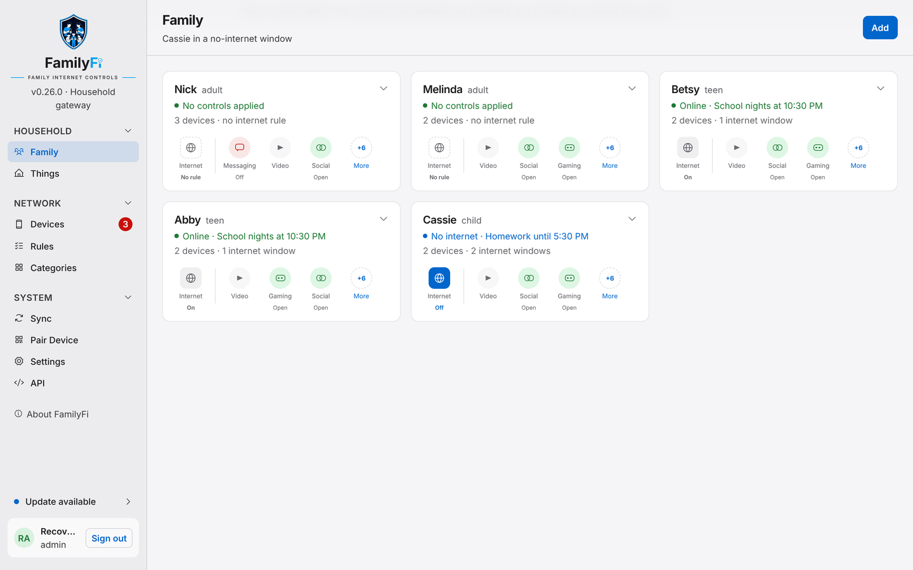
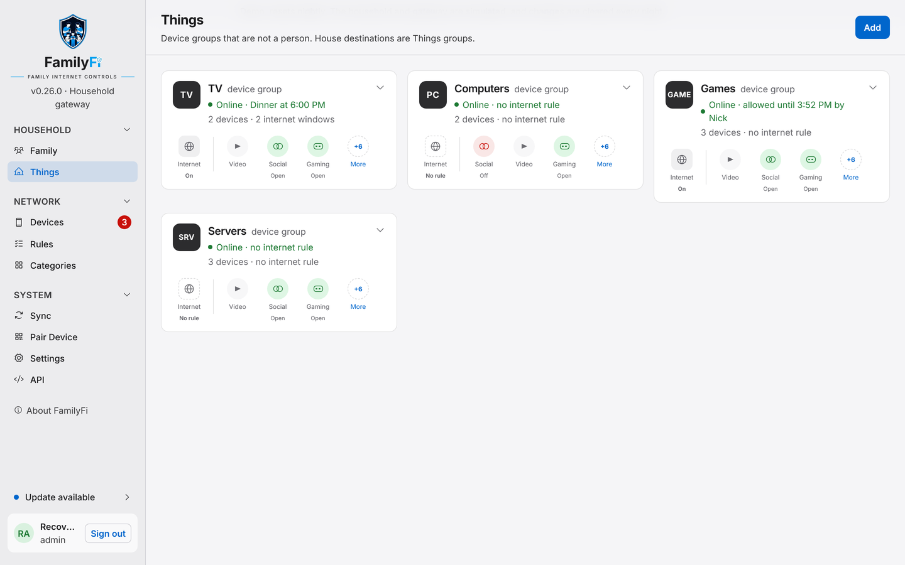
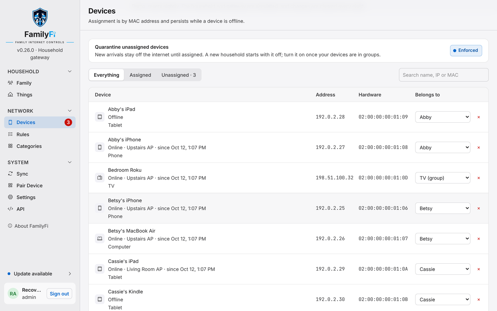

# Family, Things and devices

FamilyFi organises your network the way your house thinks about it: **people** and **things**, each with their own devices.

## Family

Each person in the household gets a card on the **Family** page, marked adult, teen or child. A card shows whether they're online right now, which schedule applies next, and how each kind of content (Video, Social, Gaming and more) is set for them.

Open a card to see today's no-internet time as a timeline, with where each part comes from, and the buttons to pause or allow (see [Rules, schedules, pause and allow](Rules-schedules-pause-and-allow)).

Adults who should manage FamilyFi can get a login in **Settings** and be made administrators. Teens and children never sign in, and neither do adults without administrator access.

## Things

**Things** are groups of devices that aren't a person: the living-room TV, the family computers, the game consoles, smart-home gear. They take the same rules as people, so the TV can have a "no video after 9 PM" schedule and nothing else.

## Devices

The **Devices** page lists every device FamilyFi has found on the networks you chose in setup, with where it's connected and which group it belongs to. Pick a group in **Belongs to** to assign a device; each device belongs to exactly one group. Assignment follows the device's hardware (MAC) address, so it sticks while the device is offline.

> Phones and tablets often use a **private Wi-Fi address**, a different one for each network. Leave it on: FamilyFi sees the address your device uses on your network, and assigning that is enough. If a device turns the setting to *rotating*, it can show up as new, so turn rotation off for your home network on that device.

## Unassigned devices and quarantine

A device that joins one of your networks shows up under **Unassigned** until you put it in a group, and the red count next to **Devices** in the menu tells you how many are waiting.

**Quarantine unassigned devices**, at the top of **Devices**, keeps those new arrivals off the internet until you assign them. That catches a new tablet, or a friend's phone that would otherwise get around the rules. A new install starts with quarantine **off**, so nobody loses internet while you're setting up; turn it on once your own devices are in groups.

Good to know:

- FamilyFi checks for new devices every few minutes, so a brand-new device can have internet briefly before it's quarantined.
- Quarantine also appears on **Rules** as a built-in rule. You can pause it there, for example while guests are over, but you can't edit or delete it.
- Devices on networks you didn't pick in setup are never quarantined or shown.
