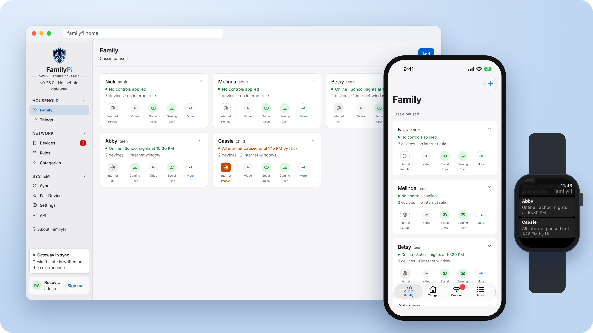

# FamilyFi

FamilyFi gives your household simple internet controls on top of your UniFi gateway. Put each person's devices in a group, set rules such as **Bedtime** or **No social media during homework**, and pause the internet for anyone with one tap, from the web or the FamilyFi app on your phone and Apple Watch.

It runs on a small computer in your home (anything that runs Docker), talks to your UniFi console, and adds its own firewall policies. **The policies you made yourself are never changed, disabled, deleted or reordered.**

**Try it first:** the [live demo](https://demo.getfamilyfi.com) runs a pretend household, so you can click around before installing anything.

## Get started

1. [Install](Install): download one file, set one password, and start it with Docker.
2. [First-time setup](First-time-setup): connect your UniFi gateway, pick your networks, add your household.
3. [Family, Things and devices](Family-Things-and-devices): put each device in the right group.
4. [Rules, schedules, pause and allow](Rules-schedules-pause-and-allow): decide what's blocked, and when.

## More

- [Phone and Watch app](Phone-and-Watch-app): pair your phone and choose how it reaches home when you're out.
  - [Quick tunnel](Remote-access-Quick-tunnel)
  - [Cloudflare (Automatic)](Remote-access-Cloudflare-Automatic)
  - [Your own Cloudflare Tunnel (Advanced)](Remote-access-Cloudflare-Tunnel)
  - [Tailscale](Remote-access-Tailscale)
  - [My domain: your own reverse proxy or VPN](Remote-access-home-network)
- [Updates and backups](Updates-and-backups)
- [Troubleshooting and FAQ](Troubleshooting-and-FAQ)

## What it costs

FamilyFi is free for your own household. It is **source-available** under the Business Source License 1.1, not open source: you can read and change the code and run it for one household network, but selling or hosting it for other households needs a commercial license. See [licensing](https://github.com/nickberardi/familyfi/blob/main/docs/licensing.md).

## Getting help

Found a bug or stuck? Open a [GitHub issue](https://github.com/nickberardi/familyfi/issues). Please remove passwords, API keys and IP addresses from anything you paste. Security problems go to the [security policy](https://github.com/nickberardi/familyfi/blob/main/SECURITY.md) instead.

---

FamilyFi is an independent project and is not affiliated with, endorsed by, or sponsored by Ubiquiti, Inc. Ubiquiti and UniFi are trademarks of Ubiquiti, Inc.
