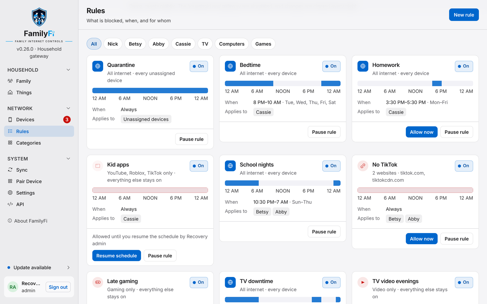
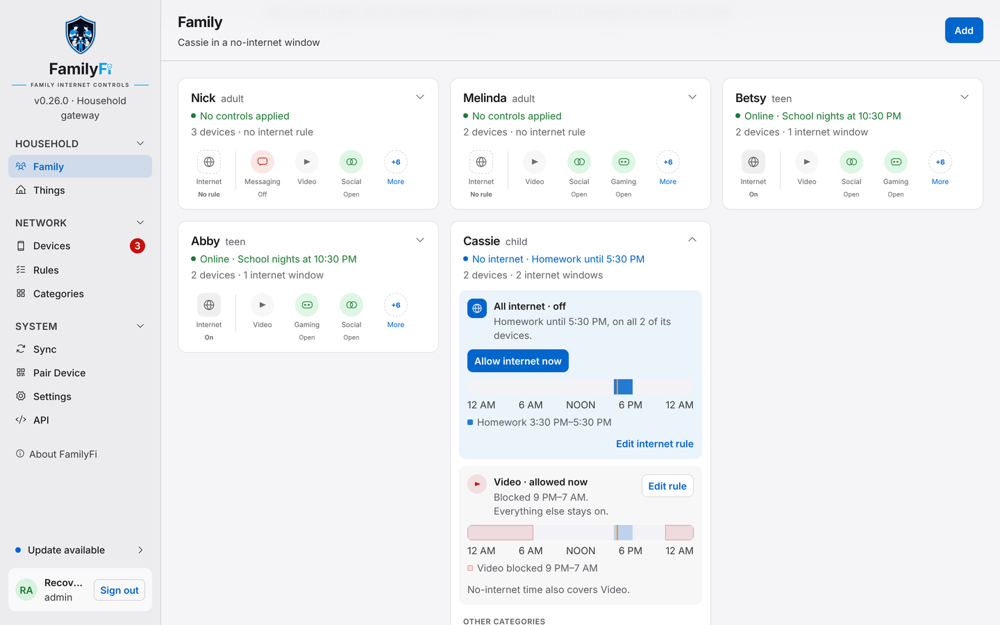

# Rules, schedules, pause and allow

## Rules

A **rule** says what to block, for whom, and when. Open **Rules** to see them all, or **New rule** to add one.

**What to block**

- **All internet**: for bedtime, homework, or school nights.
- **A category**: Video, Social, Gaming, Messaging and others, so homework time can block YouTube and TikTok but leave the school portal open.
- **Apps**: specific apps, such as Roblox or TikTok.
- **Websites**: specific domains, such as `tiktok.com`.

**When**

- **Always**, or
- in one or more **windows**, such as *Homework, 3:30–5:30 PM, Monday to Friday* or *Bedtime, 9 PM–7 AM, school nights*.

**Who**: one or more people or Things groups.

Each window becomes a policy on your UniFi gateway with the schedule built in, so **the gateway starts and ends it on time even if FamilyFi is offline**. The policies are named after your rule and window, so UniFi's own policy list reads the way your household talks.

> Website rules work by watching DNS lookups. A device using encrypted DNS (such as iCloud Private Relay, or "secure DNS" in a browser) can get around them. Category and app rules use your gateway's own app identification.

## Pause all internet

**Pause all internet** on a person's or group's card cuts off all their devices right now:

- **For 30 minutes** or **for an hour**
- **Until** a time you pick, or until their next schedule ends
- **Until I resume**

The card says who paused it and until when. **Resume** ends it early, and **Add time** makes it longer. Pauses work whether or not the person has an internet rule.

## Allow internet now

During a no-internet window, **Allow internet now** lets that person back online until the window ends, for example to finish homework that needs the internet. Category, app and website rules still apply while internet is allowed. **Resume schedule** ends the allowance.

## Pausing or allowing a whole rule

A rule card has its own buttons. **Pause rule** stops a rule from blocking anyone for a while, for example turning off *Bedtime* for a sleepover. **Allow now** lifts a schedule until its window ends. Like a person's pause, these end at the time you chose, never at a window edge.

## How it shows up on the gateway

FamilyFi only ever touches the firewall policies it created, and it keeps track of them by ID, not by name. Your own policies are never modified, disabled, deleted or reordered. If you delete a FamilyFi policy in UniFi by hand, FamilyFi puts it back on its next sync.
